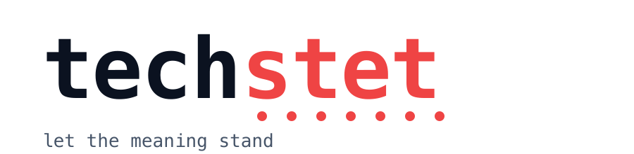

<p align="center">
  
</p>
<p align="center">
  <picture>
    <source media="(prefers-color-scheme: dark)" srcset="assets/techstet-wordmark-dark.png">
    
  </picture>
</p>

<p align="center"><strong>Let the meaning stand.</strong><br>
An agent skill that removes AI slop from technical writing, adds what the reader needs, and proves nothing was lost.</p>

<p align="center">
  <a href="#install">Install</a> ·
  <a href="#what-it-does">What it does</a> ·
  <a href="#the-gate">The gate</a> ·
  <a href="#genres">Genres</a> ·
  <a href="#why-another-deslop-skill">Why another one</a> ·
  <a href="LICENSE">MIT</a>
</p>

---

*Stet* is the proofreader's mark for "let it stand": the editor struck a line, thought again, and dotted it back in. Every slop remover changes your words. This one is built around what it keeps.

Works in **Claude Code**, **Codex CLI**, **Microsoft 365 Copilot** agents, and anything that reads the open [Agent Skills](https://agentskills.io) format.

## Install

**Claude Code**

```bash
npx skills add mrobinson2/techstet
# or
git clone https://github.com/mrobinson2/techstet ~/.claude/skills/techstet
```

Then `/techstet` in a session, or just ask it to edit a doc; the description triggers it.

**Codex CLI**

```bash
git clone https://github.com/mrobinson2/techstet ~/.agents/skills/techstet
```

Invoke with `$techstet` or `/skills`. Older Codex builds read `~/.codex/skills/` instead.

**Microsoft 365 Copilot** (agent builder or Copilot Studio)

Paste `copilot/instructions.md` into the agent's Instructions (it is under the 8,000-character limit). Build the knowledge file with `python3 scripts/build_copilot_knowledge.py` and upload the `.docx` as a knowledge source. The gate runs as a manual checklist there.

## What it does

Give it a draft. An ADR, a runbook, a design doc, a policy, an incident report, a README, an exec brief, or a chapter of a technical book.

1. **Frames the job.** Picks the genre, names one reader by role and what they leave with, builds the list of invariants: defined terms, roles, modals, numbers, headings, labels, status values, code, deliberate fragments. Takes voice from your writing sample if you give one.
2. **Marks the tells**, whole document, strongest first. Staged "not X but Y," closers that restate, deep-sounding sayings, run-up openers, straw-man alternatives, inflated significance, borrowed authority, chat residue. Then the weaker ones that need company: forced triads, repeated openings, dashes everywhere, `-ing` riders, AI vocabulary, vague declaratives, metadiscourse, sentences that fail the "so what" test. Also at section scale: every paragraph ending on a punchy line, uniform sentence length, a heading restated in its first sentence.
3. **Removes, then adds.** States the point directly. Deletes a kicker rather than improving it. Then adds concreteness from facts already in the draft: a promise opening, a fence around a new idea, a worked example, a named failure, a number with its source, a decision with its cost, a reader task, an honest gap. Never a fact, name, number, or citation the source did not supply.
4. **Runs the gate.** See below.
5. **Delivers** the text plus a short *What changed* note and the gate report.

Four modes: `edit` (default), `detect` (findings with quoted lines and fixes, no rewrite, no "87% AI" verdict), `draft` (new prose from notes), `review` (findings plus a scorecard and a figures table).

### Rules that override the usual deslop advice

The popular rules were written for essays and break technical prose.

- Keep adverbs that carry logic: *only*, *separately*, *retroactively*. Cut the ones that only add emphasis.
- Keep passive voice when the actor is unknown or irrelevant. "The certificate is rotated every 90 days" is fine.
- Keep every modal as written. *May* is permission, *might* is possibility, *should* is advice, *must* is obligation. In a policy, those are the content.
- Keep three items when the meaning has three. A checklist is not a tell.
- Never inject "you," contractions, or "however" into a neutral document to make it sound human.
- Never expand a fragment into a sentence. Table cells, labels, and status values are fragments on purpose.
- Never paraphrase for its own sake. "Sets" to "defines" helps nobody.

## The gate

After every edit, `scripts/preservation_check.py` diffs the result against the source:

```bash
python3 scripts/preservation_check.py original.md edited.md --terms terms.txt --genre policy
```

It exits non-zero on any of: a defined term rendered fewer times or as a known variant, a modal changed in any sentence, a number missing or new, a heading changed or dropped, a list label changed, a paragraph deleted or split, length outside 0.85 to 1.15, a fragment expanded, code or paths changed, a new proper noun, register leaks in a neutral genre, added passives, added dashes, removed hedges.

Every flag ends one of three ways: **revert**, **justify** (one line in *What changed*), or **ask** the author. The skill will not deliver with an unresolved flag.

`terms.txt` is one term per line; `term|variant|variant` catches known drifts such as `decider|decision-maker`.

Why this exists: on a 4,400-word governance document, a commercial "humanizer" changed 38% of lines, rendered four defined terms two ways each, turned *may* into *might*, deleted a paragraph, invented a four-state status model, and reported zero loss. On a 9,000-word book sample, mechanical checks like these caught 107 of 185 bad paragraphs before a human read them.

## Genres

`adr` · `runbook` · `design-doc` · `policy` · `incident` · `readme` · `brief` · `book-chapter` · `blog`

Each genre in `references/genres.md` fixes the voice, the engagement moves that fit, extra invariants, and whether to open with the problem (briefs, ADR context, design docs) or with the steps (runbooks, READMEs).

For books, `references/long-form.md` adds a term ledger with locked definitions, a voice card built from the author's own chapters, chapter-scale rhythm checks (one slogan, one echo close, a restatement only if the author does it), cross-chapter callbacks, and re-entry landmarks.

## Why another deslop skill

| | Removes tells | Adds what the reader needs | Proves nothing was lost | Written for |
|---|---|---|---|---|
| humanizer, unslop, no-ai-slop, stop-slop | yes | opinions, first person, voice | no | essays, posts |
| paraphrase "humanizers" (API) | word swaps | no | numbers only | detector evasion |
| **techstet** | yes, tiered by evidence | examples, costs, sourced numbers, next actions | mechanical gate | ADRs, runbooks, policies, books |

The catalogs are built on the best of those skills (credits below) with the absolutes removed and technical examples throughout. The gate and the genre rules are new.

## Layout

```
SKILL.md                         the workflow; read this first
references/tells.md              tiered tell catalog, technical examples
references/engagement.md         the "add" half: moves, capped devices, scorecard
references/genres.md             per-genre voice, moves, invariants
references/preservation-gate.md  what the gate checks and how to resolve a flag
references/long-form.md          books and long documents
scripts/preservation_check.py    the gate (Python 3.9+, stdlib only)
scripts/build_copilot_knowledge.py
agents/openai.yaml               Codex CLI interface
copilot/instructions.md          self-contained core for M365 Copilot
evals/                           test prompts and fixtures
assets/                          icon and wordmark
```

## Credits

Built on the shoulders of [humanizer](https://github.com/blader/humanizer) by blader (MIT; patterns from Wikipedia's "Signs of AI writing"), [no-ai-slop](https://github.com/petergyang/no-ai-slop) by Peter Yang, [stop-slop](https://github.com/hardikpandya/stop-slop) by Hardik Pandya (MIT), and the tagore merge of the two. The speaking-craft translations draw on Patrick Winston's *How to Speak* and Simon Sinek's giver mindset. The gate was shaped by reverse-engineering what paraphrase tools break.

## License

MIT. Copyright (c) 2026 Michael Robinson.
